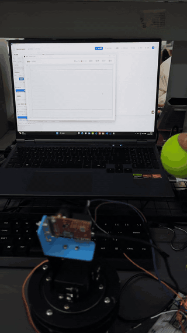
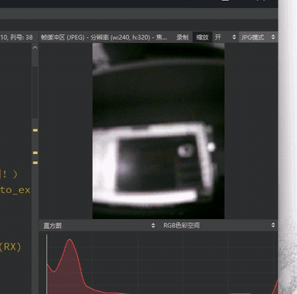
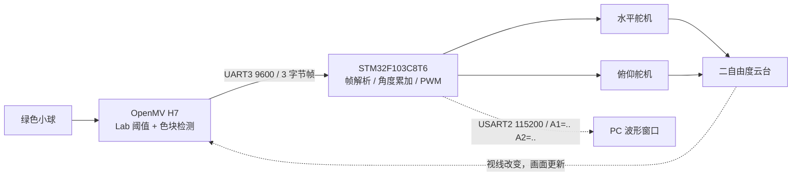
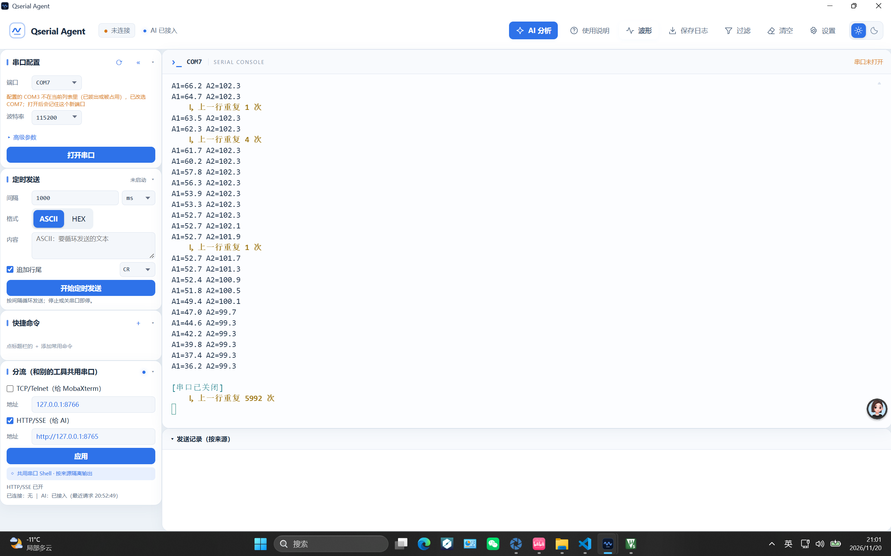

# OpenMV Tracking Gimbal

**基于 OpenMV + STM32 的二自由度视觉伺服云台**

摄像头识别绿色小球 → 计算它偏离画面中心多少 → 串口发出"往哪边、多快"的指令 → STM32 解析并驱动两只 25 KG 舵机 → 云台转动后画面变化，继续修正。主循环约 **46 fps**，带一路独立的角度遥测，能在电脑上实时看到两轴波形。

`OpenMV H7` · `STM32F103C8T6` · `MicroPython` · `C` · `UART` · `PWM`

---

## 演示

<table>
  <tr>
    <td align="center" width="40%">
      <br>
      <sub>实物云台 + 双轴角度波形 · <a href="media/waveform-demo.mp4">完整视频（8.6 s）</a></sub>
    </td>
    <td align="center" width="60%">
      <br>
      <sub>OpenMV IDE 实时跟踪 · <a href="media/openmv-tracking-demo.mp4">完整录屏（17.5 s）</a></sub>
    </td>
  </tr>
</table>

左边是实际搭起来的云台：蓝色 3D 打印支架上装着 OpenMV、水平舵机和俯仰舵机，电脑上是两轴指令角度的实时波形。右边是 OpenMV IDE 的帧缓冲区，红色矩形和十字标出的是绿色小球。

## 这个项目做了什么

- OpenMV 负责“看”：QVGA 采集、Lab 阈值分割、`find_blobs` 找绿色小球、算质心与画面中心的像素偏差。
- STM32 负责“转”：USART1 接收 3 字节指令帧，按帧累加水平/俯仰角度，输出两路 50 Hz PWM 驱动 25 KG 舵机。
- 两轴解耦：图像先旋转 90°，让画面的左右对应云台水平轴、上下对应俯仰轴。
- 控制方式：死区 + 快慢两档的离散比例控制，一帧走一步；没有堆 PID，参数少、行为可解释。
- 观测手段：STM32 的 OLED 显示收到的 H/V 命令；USART2 把两轴角度以 115200 发到电脑，串口工具的波形窗口实时画出 `pan`、`tilt` 两条曲线。

## 项目结构



### 硬件

| 模块 | 型号 / 参数 | 作用 |
|---|---|---|
| 视觉 | OpenMV H7，固件 5.1.1 | 图像采集、色块识别、偏差计算 |
| 主控 | STM32F103C8T6，72 MHz | 串口帧解析、角度累加、PWM 输出 |
| 执行 | DSSERVO 25 KG 数字舵机 ×2 | 水平（PAN）、俯仰（TILT） |
| 电源 | 外部 6 V，建议 ≥5 A | 舵机独立供电，与主控共地 |
| 调试 | CH340 USB-TTL | 角度遥测、串口调试 |

### 接线

| 连接 | 说明 |
|---|---|
| OpenMV P4（UART3 TX）→ STM32 PA10（USART1 RX） | 控制指令，单向 |
| OpenMV GND ↔ STM32 GND | 必须共地 |
| STM32 PA0（TIM2_CH1）→ 水平舵机信号 | 50 Hz PWM |
| STM32 PA1（TIM2_CH2）→ 俯仰舵机信号 | 50 Hz PWM |
| 舵机红线 → 6 V +，棕线 → 6 V − | 负极与 STM32、OpenMV 共地 |
| STM32 PA2（USART2 TX）→ CH340 RXD | 角度遥测，115200 |

> 25 KG 舵机堵转电流大，不能用板载 5 V/3.3 V 供电；PA10 已经被 OpenMV 占用，USB-TTL 的 TXD 不要再接到 PA10。

## 关键实现

### 1. 视觉端：像素偏差就是控制误差

程序在 QVGA（320×240）下工作，上电先预热约 2 秒，然后锁定自动增益、白平衡和曝光。锁定这一步很关键：阈值是一组固定的 Lab 数值，曝光如果每帧都变，同一个物体的颜色就会漂。

绿色目标的阈值为 `(30, 80, -60, 5, 20, 28)`，在实验室光线下用阈值编辑器现场框出来。`find_blobs` 只取像素数最大的色块，计算质心 `(cx, cy)`，偏差为：

```text
ex = cx - 图像宽度/2
ey = cy - 图像高度/2
```

这里没有把像素换算成角度，而是直接把 `(ex, ey)` 交给后续控制。视觉闭环会把误差一点点压到死区内，因此舵机的线性度、安装偏角都不需要单独建模。

### 2. 图像旋转：让两个轴真正分开

摄像头在云台支架上是横着装的，原始画面的“左右”并不对应云台的水平轴。代码在 `snapshot()` 之后立即旋转 90°：

```python
img = csi0.snapshot().scale(hint=image.ROTATE_270)
```

旋转后画面变成 240×320，中心自动变成 `(120, 160)`。如果不做这一步，水平偏差会去驱动俯仰，两个轴互相打架。

### 3. 控制律：死区 + 两档速度

每个轴只有五种状态：快、慢、停、反方向快、反方向慢。误差小于死区就不动，超过快档阈值就用大步长，介于两者之间用慢步长。本质上是一个量化的比例控制器，带一个容差带。

| 误差 \|e\| | 输出 |
|---|---|
| ≤ 死区（水平 20 px / 垂直 15 px） | 停止 |
| 死区 ~ 快档阈值（35 / 30 px） | 慢速，0.3° / 0.2° 每帧 |
| > 快档阈值 | 快速，1.2° / 1.0° 每帧 |

没有用 PID，原因在调试记录里会详细说：视觉闭环本身就在消除稳态误差，积分项容易在丢目标、死区和限位时饱和；微分项会被像素质心抖动和几十毫秒延迟放大。对“把球保持在画面里”这个任务，带死区的两档控制更稳，也更容易解释。

### 4. 串口协议：3 字节，坏帧能自己恢复

控制帧固定为 3 个字节：

```text
[水平命令] [垂直命令] 0x0A('\n')
```

命令字符：`a/b/c/d/o` 控制水平，`x/z/y/w/o` 控制俯仰，快慢和方向各占一档。接收端不关心“这是第几个字节”，只按规则切帧：缓冲里凑满 2 个命令字节、再遇到 `0x0A` 才算一帧有效；长度不对就整帧丢弃，等下一个帧尾重新对齐。这样丢字节、多字节或丢帧尾，最多坏掉当前一帧。

### 5. STM32：中断组帧，主循环执行

USART1 的 RXNE 中断里维护一个 2 字节缓冲和下标，收到 `'\n'` 时校验长度，正好 2 就提交成完整帧并置标志。主循环看到标志后，两轴各累加一次角度，做 0°~180° 限幅，再刷新 PWM。

没有完整帧时主循环什么也不做，舵机保持原位——增量式指令的好处是：通信断掉不会失控。

舵机由 TIM2 的两路通道驱动：72 MHz 下预分频 72−1、周期 20000−1，得到 50 Hz、20 ms；角度 0°~180° 映射到 0.5~2.5 ms 脉宽，对应比较值 500~2500。

### 6. 遥测：把内部状态变成波形

控制链路仍用 9600，遥测单独走 USART2：PA2、115200、只发不收。每收到两帧，往电脑发一行：

```text
A1=95.0 A2=91.9
```

电脑端用 Qserial Agent 的波形窗口，规则填：

```text
A1=(?<pan>[0-9.-]+) A2=(?<tilt>[0-9.-]+)
```

两条曲线就是两轴的指令角度。它不能代替编码器，但用来观察“指令有没有发出去、速度快慢、死区停顿、限位削平”非常直观。

## 调试实录：真正花时间的地方

这部分是项目里最耗时间的环节，也是我认为最能说明“确实自己动手做过”的地方。

### ① 三个字节的帧，STM32 只看到了最后一个换行

最初的接收只有一个 `Serial_RxData` 和一个标志位，来一个新字节就覆盖旧值。9600 下一个字节约 1.04 ms，一帧 3 字节约 3.1 ms 全部到齐；而主循环里有 OLED 刷新和 `Delay_ms(4)`，一次取数要 5 ms 左右，结果往往只取到帧尾的 `0x0A`。`0x0A` 在指令表里没有对应动作，于是看起来就像“什么都没发生”。

改法是在中断里组帧：2 字节缓冲、`'\n'` 校验、完整帧标志，主循环只处理整帧。改完之后 OLED 的 H/V 才和 IDE 打印的 `send:` 对上。

### ② OpenMV 5.x 和网上教程的 4.x 不是一回事

识别稳定后开始画框和十字，连续踩了两个版本坑：

- `find_max` 里写 `b.pixels()`，报 `'int' object isn't callable`。v5 的 Blob 是 attrtuple，属性不带括号，改成 `b.pixels`、`b.cx`、`b.cy` 才通过。
- 画十字写 `draw_cross(b.cx, b.cy)`，报 `object 'int' isn't a tuple or list`。v5 要求坐标打包成元组，改成 `draw_cross((b.cx, b.cy))`。

这两次报错之后，我再参考网上例程都会先确认固件版本，或者先在 REPL 里 `dir()` 一下再写进主程序。

### ③ 串口助手发 `ay` 没反应，发 `61 79 0A` 就好了

用串口助手单独测 STM32 时，文本模式发送 `ay` 加换行一直没反应，换成 HEX 发 `61 79 0A` 立刻正常。原因是工具默认在行尾补了 `\r\n`，帧变成三个字符被长度校验判掉。后来在中断里加了忽略 `\r` 的处理，LF 和 CRLF 都能正常收发，调试时少了一个容易误判的坑。



*上图：串口工具里持续输出的两轴角度，每两帧一行，约 20 多条每秒。*

### ④ 方向标反：云台越追越远，直接顶到限位

方向标定时先按假设写，实测发现俯仰轴正好反了：目标在画面下方，云台却抬头，偏差越来越大，最后顶到限位。把 `x/z` 与 `y/w` 两组的加减号对调后，动作才和画面一致。水平方向也用同样方法验证：目标放在画面右侧保持不动，看云台是转向目标还是转离目标。方向反了会形成正反馈，看起来像“程序乱了”，其实只是符号错了。

### ⑤ 目标不动，水平轴却在小幅抖

先怀疑死区太小，把 `DEAD_X` 从 15 调到 20、`FAST_X` 从 30 调到 35，抖动有所收敛。后来学会看 OLED：如果抖动时 `H:` 一直显示 `o`，说明指令并没有来回跳，问题就不在控制律，而要查机械间隙、舵机供电和信号线干扰。这个判断方法比盲目调参数有效得多。

### ⑥ LCD 一直白屏，最后放弃

中途给 OpenMV 加过一块 1.8 寸 LCD 扩展板，想直接在云台上看画面。实际效果是白屏，偶尔变成满屏噪点；默认的 `SPIDisplay` 初始化不匹配，固件 5.1.1 里又没有文档里的 `display.SSD1351` 控制器类，刷回 V4 又因为板子和固件不匹配烧不进去。确认排针、供电和控制器都排查过之后，我决定不再在这块屏上耗时间：调试看 IDE 帧缓冲区，演示用电脑端波形。屏只是辅助，不能让它拖住主线。

### ⑦ 球一快就跟不上

云台的最大角速度由“每帧步长 × 帧率”决定：快档 1.2°/帧、46 fps，约 55°/s；慢档 0.3°/帧，约 14°/s。球一快，镜头就跟不上，球逐渐跑到画面边缘，最后出画。

试过把快档步长加到 2.0°/帧（水平）和 1.5°/帧（俯仰），上限能到 90°/s 左右，但中心附近更容易过冲，和死区、延迟一起引起来回摆。更根本的办法是估计球的速度做前馈，让云台提前往球要去的方向走，而不是等偏差出现再追；这次先把基础闭环调稳，前馈留作下一步。

## 参数与协议

### 视觉参数

| 项目 | 值 |
|---|---|
| 分辨率 / 格式 | QVGA 320×240，RGB565 |
| 绿色阈值（Lab） | `(30, 80, -60, 5, 20, 28)` |
| 色块过滤 | `pixels_threshold=100`，`area_threshold=100`，`merge=True` |
| 图像旋转 | `ROTATE_270`，输出 240×320 |
| 主循环帧率 | 约 46 fps |

### 控制参数

| 项目 | 水平（PAN） | 垂直（TILT） |
|---|---|---|
| 死区 | 20 px | 15 px |
| 快档阈值 | 35 px | 30 px |
| 快档步长 | 1.2°/帧 ≈ 55°/s | 1.0°/帧 ≈ 46°/s |
| 慢档步长 | 0.3°/帧 ≈ 14°/s | 0.2°/帧 ≈ 9°/s |
| 角度范围 | 0°~180° | 0°~180° |

### 命令表

| 字节 | 取值 | 含义（设计约定） |
|---|---|---|
| 水平 | `a / b` | 快速 / 慢速，正向修正 |
| 水平 | `c / d` | 快速 / 慢速，反向修正 |
| 水平 | `o` | 保持当前角度 |
| 垂直 | `x / z` | 快速 / 慢速，正向修正 |
| 垂直 | `y / w` | 快速 / 慢速，反向修正 |
| 垂直 | `o` | 保持当前角度 |

> 正向/反向最终由舵机安装方向决定，联调时现场标定；协议层不依赖机械细节。

## 目录结构

```text
.
├── openmv/
│   └── tracker.py                  # OpenMV 视觉端主程序（MicroPython, csi 接口）
├── stm32/
│   ├── openmv_tracking_gimbal.uvprojx   # Keil MDK5 工程
│   ├── User/main.c                 # 帧解析、角度累加、PWM、遥测
│   ├── hardware/                   # Serial / Servo / PWM / OLED
│   ├── library/                    # STM32 标准外设库
│   └── start/                      # 启动文件与系统文件
├── media/                          # 演示图片、GIF、视频
├── docs/
│   └── project-report.pdf          # 完整项目报告（12 页）
└── README.md
```

## 如何复现

### OpenMV 端

1. 固件需要 **5.x**（本项目使用 5.1.1，`csi` 接口；4.x 固件需要把 `csi` 换成 `sensor` 写法）。
2. 打开 `openmv/tracker.py`，用 OpenMV IDE 的阈值编辑器按现场光线重新调 `GREEN_THRESHOLD`。
3. 确认 `UART(3, 9600)` 与 STM32 一致，运行脚本，帧缓冲区里应看到红框和十字。

### STM32 端

1. Keil MDK5（ARM Compiler 5）打开 `stm32/openmv_tracking_gimbal.uvprojx`。
2. F7 编译，F8 通过 ST-Link 下载（SWDIO / SWCLK / GND）。
3. USART1 接 OpenMV，TIM2_CH1/CH2 接两只舵机，舵机电源用独立 6 V 并共地。

### 联调顺序

1. 先只接串口，看 OLED 的 `H:` / `V:` 是否与 OpenMV 终端里的 `send:` 一致；
2. 再给舵机上电，把目标放在画面右侧保持不动，确认云台转向目标而不是转离目标；
3. 最后调死区和快慢档，观察波形窗口里的台阶、停顿和限幅。

## 结果与不足

- 正常速度移动的小球可以稳定跟踪，红框和十字能持续套住目标；
- 46 fps 下水平快档约 55°/s、慢档约 14°/s，俯仰快档约 46°/s、慢档约 9°/s；
- 球速超过云台最大角速度时会出画，下一步准备加速度前馈；
- 水平轴在目标静止时仍有轻微抖动，控制参数只能解释一部分，机械间隙和供电质量也占很大比重；
- 没有角度反馈，STM32 只知道指令角度，不知道舵机实际到了哪里；颜色阈值固定，换环境需要重调；
- 目标丢失后只会停住，不会主动搜索。

## 完整报告

更详细的设计、调试过程和数据整理在：[docs/project-report.pdf](docs/project-report.pdf)（12 页）。

## English Summary

A 2-DOF visual-servo gimbal built with OpenMV H7 and STM32F103C8T6. The camera detects a green ball with a Lab threshold, computes the pixel offset from the image center, and sends a 3-byte command frame over UART. The STM32 assembles frames in the RX interrupt, applies angle increments with a dead zone and two speed levels, and drives two 25 kg servos at 50 Hz. The loop runs at about 46 fps; a separate USART2 telemetry link streams both axis angles to a PC waveform window.

---

本项目为个人学习与课程作品，代码仅供学习交流。
